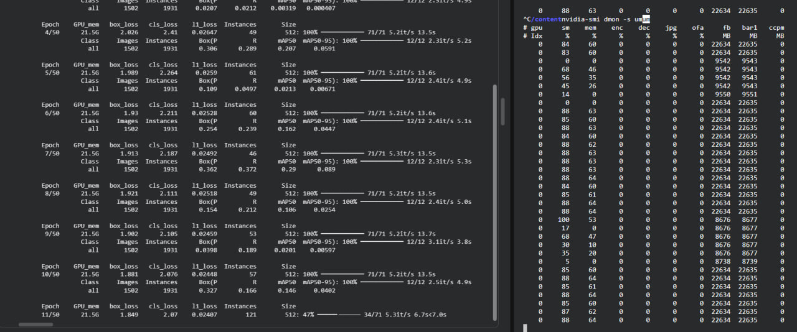

# RSNA Pneumonia: классификатор + детектор

Учебный проект на данных соревнования [RSNA Pneumonia Detection Challenge](https://www.kaggle.com/competitions/rsna-pneumonia-detection-challenge).
Идея простая: обучить классификатор и детектор, соединить их через пороги и посмотреть на итоговую метрику соревнования.

```
рентген (DICOM)
   │  перцентильный клип, ресайз (512 или 640)
   ▼
ConvNeXt V2 ──► 3 класса: норма / изменения без пневмонии / пневмония
   │
   │  P(пневмония) ≥ t2 ?
   ├── нет ──► боксов нет
   ▼  да
YOLO26 ──► боксы очагов с уверенностью ≥ conf
```

Оба порога подобраны **вместе** на валидации по метрике соревнования. Классификатор нужен, чтобы детектор не рисовал боксы на здоровых снимках: по правилам соревнования любой бокс на снимке без пневмонии обнуляет его оценку.

## Эксперименты

| Версия | Классификатор | YOLO | Сплит | t2 | conf | цепочка, val | Kaggle Private | Kaggle Public |
|---|---|---|---|---|---|---|---|---|
| **v1** | ConvNeXt V2 Tiny, 512, без аугментаций | YOLO26m, 512 | 60 / 20 / 20 | 0.50 | 0.25 | 0.221 | **0.121** | 0.048 |
| v2 | ConvNeXt V2 Base, 640, с аугментациями | YOLO26l, 640, ранняя остановка на 24-й эпохе | 80 / 20 | 0.25 | 0.25 | 0.174 | 0.083 | 0.024 |
| v2.1 | то же, что v2 | YOLO26l, 640, все 50 эпох | 80 / 20 | 0.25 | 0.25 | 0.211 | 0.119 | 0.042 |
| A | классификатор v1 (Tiny, 512) | YOLO v2.1 (26l, 640) | val v2 | 0.40 | 0.25 | 0.214 | 0.117 | 0.042 |
| B | классификатор v2 (Base, 640) | YOLO v1 (26m, 512) | val v2 | 0.20 | 0.30 | 0.207 | 0.116 | 0.056 |
| **Ансамбль** | среднее Tiny 512 и Base 640 | WBF YOLO26m 512 и YOLO26l 640 | val v2 | 0.45 | 0.10 | 0.226 | **0.154** | 0.058 |

- t2 = 0 означает «только YOLO, без классификатора». Классификатор стабильно добавляет к метрике на val около +0.01…0.025.
- В v2 бывший test ушёл в обучение, проверка — только на Kaggle. Поэтому val в v1 и v2 — разные снимки, и сравнивать версии стоит по Kaggle.
- В A, B и ансамбле каждая модель обучалась на своём сплите, поэтому часть снимков val одна из них видела при обучении. Пороги у этих комбинаций подобраны не совсем честно, но Kaggle остаётся честным тестом.
- Ранние попытки, не вошедшие в ноутбуки: обучение на фолдах — Kaggle 0.094; отдельные пороги для AP и PA — 0.086.

**Выводы.** Крупные модели, разрешение 640 и аугментации прироста не дали: macro F1 классификатора остался около 0.73, mAP50 YOLO — около 0.53. Сильнее всего на результат повлияло расписание обучения. Ранняя остановка на длинном OneCycle/линейном расписании останавливает обучение, пока lr ещё высокий, поэтому v2 вышел заметно хуже v2.1. Перекрёстные комбинации A и B дали те же 0.116–0.117: если модели нормально доучены, их сочетание почти не влияет на результат, и одиночные модели упираются в потолок около 0.12. Пробил его только ансамбль: средняя вероятность двух классификаторов и объединение боксов двух YOLO через WBF дали 0.154 без всякой подгонки под Kaggle.

### Пост-обработка: сжатие боксов

Разметка train сделана одним радиологом, а тест соревнования — пересечением разметки трёх, поэтому тестовые боксы меньше. Так делали и лучшие решения соревнования: каждый предсказанный бокс сжимается к своему центру в K раз, без переобучения моделей.

| Сабмит | без сжатия | K = 0.875 | K = 0.85 | K = 0.8 | K = 0.75 |
|---|---|---|---|---|---|
| **v1** | 0.121 | | **0.146** | 0.144 | |
| v2.1 | 0.119 | | 0.138 | 0.135 | |
| B | 0.116 | 0.143 | | 0.145 | 0.138 |
| **Ансамбль** | 0.154 | | **0.175** | 0.165 | |

(Kaggle Private. У ансамбля при K = 0.7 — 0.126.) Сжатие даёт около +0.02…0.03 при любых моделях, лучший K — около 0.8–0.85. **Важно:** K подобран прямо по Kaggle, поэтому эти цифры — уже подгонка под лидерборд, а не честный тест. Честный результат — колонка «без сжатия».

### v1 подробно

Данные разделены на train / val / test = 60 / 20 / 20 со стратификацией по классу и проекции снимка (AP/PA). Модели и пороги выбирались на val, test использован один раз.

| Модель | Метрики на test |
|---|---|
| классификатор ConvNeXt V2 Tiny | ROC-AUC (ovr) 0.890 · macro F1 0.726 · recall класса 2 — 0.668 |
| детектор YOLO26m (снимки с пневмонией + 25% фона) | Precision 0.496 · Recall 0.580 · mAP50 0.521 · mAP50-95 0.196 |
| цепочка, метрика соревнования | val 0.221 · test 0.205 · Kaggle Private **0.121** · Public 0.048 |

Результат на закрытом тесте Kaggle **невысокий**: примерно вдвое ниже нашей валидации и заметно ниже лучших решений соревнования. Цепочка нарисовала боксы на 21% тестовых снимков — примерно как доля пневмонии в данных (23%), то есть на тесте она ведёт себя так же, как на наших снимках. Скорее всего, дело в самом подходе к решению: модели обучались на «одиночной» разметке train, а тест соревнования, по всей видимости, размечен иначе. К тому же детектор находит только около половины очагов, а метрика очень строгая к точности боксов.

### Shortcut: смотрит ли модель на лёгкие

AP-снимки делают лежачим пациентам, и среди них пневмония встречается в 4 раза чаще, чем среди PA. Модель могла бы выучить «AP → болен» вместо признаков в лёгких. Проверка на test v1:

| | AUC класса 2 |
|---|---|
| только по проекции AP/PA, без снимка | 0.706 |
| модель, все снимки | **0.890** |
| модель, только AP | 0.843 |
| модель, только PA | 0.875 |

Внутри одной проекции подсказка «AP → болен» не работает, а модель всё равно различает пневмонию. Значит, она опирается на признаки в лёгких. Это подтверждают и карты Grad-CAM в ноутбуке классификатора.

## Ноутбуки

| Ноутбук | Что внутри |
|---|---|
| [`v1/01_classifier_ConvNeXt_V2_Tiny_no_aug`](notebooks/v1/01_classifier_ConvNeXt_V2_Tiny_no_aug.ipynb) | EDA, препроцессинг DICOM, сплит 60/20/20, обучение ConvNeXt V2 Tiny, тест, shortcut, Grad-CAM, порог по Жаккару |
| [`v1/02_yolo26m_thresholds_kaggle`](notebooks/v1/02_yolo26m_thresholds_kaggle.ipynb) | датасет YOLO, обучение YOLO26m, метрика соревнования, подбор порогов, тест, отправка на Kaggle |
| [`v2/01_classifier_ConvNeXt_V2_Base_with_aug`](notebooks/v2/01_classifier_ConvNeXt_V2_Base_with_aug.ipynb) | то же для ConvNeXt V2 Base, 640, с аугментациями, сплит 80/20 |
| [`v2/02_yolo26l_thresholds_kaggle`](notebooks/v2/02_yolo26l_thresholds_kaggle.ipynb) | YOLO26l, 640, пороги, Kaggle (запуск v2.1, все 50 эпох) |
| [`03_cross_combinations`](notebooks/03_cross_combinations.ipynb) | комбинации A и B: модели v1 и v2 вперемешку, пороги на val v2, Kaggle |
| [`ensemble/04_ensemble`](notebooks/ensemble/04_ensemble.ipynb) | ансамбль: средняя вероятность двух классификаторов, боксы двух YOLO через Weighted Boxes Fusion, Kaggle со сжатием боксов K = 1.0 / 0.85 / 0.8 / 0.7 |
| [`05_shrink_boxes`](notebooks/05_shrink_boxes.ipynb) | сжатие боксов готового сабмита к центру в K раз, без моделей |

Ноутбуки писались и запускались в Google Colab (A100), пути в них такие:

| Что | v1 | v2 |
|---|---|---|
| архив соревнования | `/content/drive/MyDrive/rsna-pneumonia-detection-challenge.zip` | то же |
| распакованные снимки | `/content/extract_dir/stage_2_train_images/`, `stage_2_test_images/` | то же |
| папка проекта | `/content/drive/MyDrive/rsna_project_final/` | то же |
| таблицы | `meta_classifier_ConvNeXt_V2_Tiny_no_aug.csv`, `boxes_512_classifier_ConvNeXt_V2_Tiny_no_aug.csv` | `meta_classifier_ConvNeXt_V2_Base_with_aug.csv`, `boxes_640_classifier_ConvNeXt_V2_Base_with_aug.csv` |
| классификатор: веса и вероятности | `classifier_ConvNeXt_V2_Tiny_no_aug/` | `classifier_ConvNeXt_V2_Base_with_aug/` |
| датасет YOLO | `/content/dataset/` | `/content/dataset/` |
| запуски YOLO | `yolo/split_v1_yolo26m/` | `yolo/split_v2_yolo26l_2/` |
| сабмиты | `submission_*.csv` в папке проекта | то же; ансамбль — в `ensemble/` |

**Кроп по лёгким не реализован.** В исходном плане перед ресайзом снимок обрезался по лёгким: сегментация лёгких готовой моделью (например, из `torchxrayvision`) → bbox лёгких с отступом 5–10% → кроп → пересчёт боксов со сдвигом и масштабом. Это должно было убрать маркеры, надписи и плечи и отдать лёгким больше пикселей. В итоговой версии этого шага нет: обе модели работают по всему снимку.

Загрузка GPU во время обучения YOLO: видеокарта занята на 85–88%, просадки — это валидация в конце каждой эпохи.



## Как использовать

### Файлы

```
predict.py                           # ансамбль: пороги, загрузка 4 моделей, функция predict
models/
  v1/classifier_best_for_f1.pt       # ConvNeXt V2 Tiny, 1 канал, 3 класса, вход 512×512
  v1/yolo_best.pt                    # YOLO26m, 1 класс (opacity), вход 512×512
  v2/classifier_best_for_f1.pt       # ConvNeXt V2 Base, вход 640×640
  v2/yolo_best.pt                    # YOLO26l, вход 640×640 (запуск v2.1)
```

Веса классификаторов больше лимита GitHub на один файл (100 МБ), поэтому они выложены в **GitHub Releases** (или хранятся через Git LFS — `.gitattributes` уже настроен). Скачанные файлы нужно положить в `models/v1/` и `models/v2/`.

### Установка

```bash
pip install -r requirements.txt
```

### Из своего кода

Запускать из папки репозитория (пути к моделям в `predict.py` относительные).

```python
from predict import predict

probs, boxes, out_path = predict(input("Путь к .dcm: "))
print(probs)      # [норма, изменения без пневмонии, пневмония]
print(boxes)      # [[x, y, width, height, conf], ...] в пикселях исходного снимка
print(out_path)   # картинка с разметкой
```

### Из командной строки

```bash
python predict.py
```

Скрипт спросит путь к DICOM-снимку. Рядом со снимком сохраняется `<имя>_pred.png`: красные рамки — найденные очаги с уверенностью, сверху — предсказанный класс и вероятность пневмонии.

Внутри `predict.py` — те же функции препроцессинга, что в ноутбуках, и лучший вариант из экспериментов: ансамбль из `04_ensemble` (средняя вероятность двух классификаторов, боксы двух YOLO через WBF) со сжатием боксов. Константы: `CLS_THRESHOLD = 0.45`, `YOLO_CONF = 0.10`, `K = 0.85`; `K = 1.0` отключает сжатие. Чтобы запустить одну пару моделей, оставьте по одной строке в `CLASSIFIERS` и `YOLOS` и поставьте её пороги из таблицы экспериментов. Если есть GPU, используется он.

## Ограничения

- Проект учебный и **не предназначен для клинического использования**.
- Один сплит без кросс-валидации, поэтому у цифр есть разброс порядка ±0.01–0.02.
- В v1 классификатор обучался **без аугментаций** (функция аугментаций описана, но не подключена к `train_ds`), отсюда быстрое переобучение после 4-й эпохи. В v2 аугментации включены.
- Разметка RSNA шумная: врачи-разметчики заметно расходились в границах очагов.

## Данные и благодарности

- Данные: [RSNA Pneumonia Detection Challenge](https://www.kaggle.com/competitions/rsna-pneumonia-detection-challenge), Radiological Society of North America. Сами снимки в репозиторий не входят, их нужно скачать с Kaggle после принятия правил соревнования.
- Grad-CAM: [jacobgil/pytorch-grad-cam](https://github.com/jacobgil/pytorch-grad-cam) (MIT), код визуализации взят почти без изменений.
- Классификаторы: [timm](https://github.com/huggingface/pytorch-image-models), ConvNeXt V2 Tiny (`convnextv2_tiny.fcmae_ft_in22k_in1k`) и Base (`convnextv2_base.fcmae_ft_in22k_in1k_384`).
- Детекторы: [Ultralytics YOLO](https://github.com/ultralytics/ultralytics) (AGPL-3.0), YOLO26m и YOLO26l.
